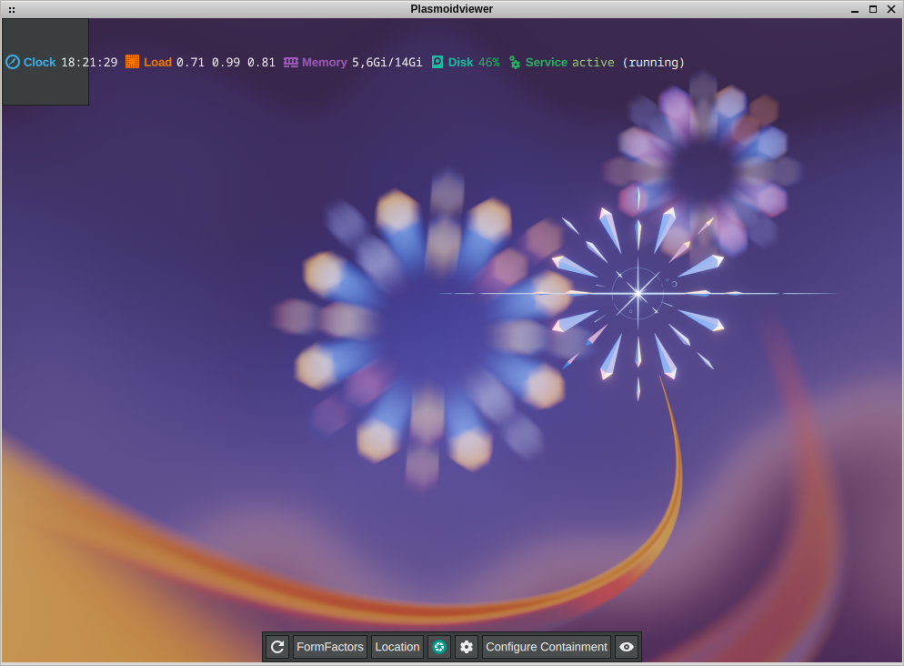
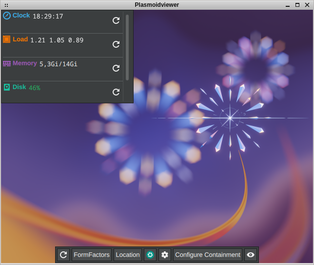

<div align="center">

# Command Monitor

A KDE Plasma 6 widget that runs your own shell commands on their own
schedules and shows their colored output in your panel or on your desktop.


</div>





## Features

- Every command has its own timer, from 1 second to 24 hours.
- ANSI colors from the command output, plus your own regex color rules
  (`error` in red, `ok` in green, and so on).
- Per-entry icon, name color, bold/italic, and an option to hide the entry
  when its output is empty.
- A click command for each entry (`notify-send`, `xdg-open`,
  `systemctl restart ...`).
- Right-click to copy any command's output to the clipboard.
- Refresh on demand from the popup list.
- Low CPU use: Plasma's own engine schedules the runs, the QML never polls,
  and fast commands pause while the popup is closed.

## Install

```sh
git clone https://github.com/drvy/plasma-command-monitor.git
cd plasma-command-monitor
./install.sh install
```

Then add **Command Monitor** from the widget list. It needs KDE Plasma 6.0 or
newer.

To build a package instead, run `./install.sh package` and install the
resulting `.plasmoid` with `kpackagetool6 -t Plasma/Applet -i <file>.plasmoid`.

## Setup

Right-click the widget, choose **Configure...** and add some commands. Each
one has these options:

| Option | What it does |
| --- | --- |
| Name / command | What to show and what to run |
| Interval | 1s to 24h |
| Icon & color | Shared by the icon and the name |
| Bold / italic | Independent for the name and the output |
| Click command | Runs when you pick "Run command" from the right-click menu |
| Hide when empty | Hides the entry when it has no output |
| Color rules | `{pattern, color}` regex rules for plain-text output |

Each entry is shown as `[icon] name output`, in list order (use the arrows to
reorder).

Left click opens the popup with every command. Right click keeps Plasma's
usual menu (Configure, Remove...) and adds **Run command** and **Copy to
clipboard** for the entry under the pointer.

Click commands are fire-and-forget: their output isn't shown.

## Development

```sh
./install.sh preview   # standalone plasmoidviewer, fastest loop
./install.sh upgrade   # reinstall after edits
```

`plasmoidviewer` comes from `plasma-sdk`. Architecture notes and gotchas are in
[`CLAUDE.md`](CLAUDE.md). Read [`CONTRIBUTING.md`](CONTRIBUTING.md) before
opening a PR. Every source file has an SPDX header and every UI string goes
through `i18n()`, so translations are welcome.

## License

[MIT](LICENSE) © Dragomir Yordanov
